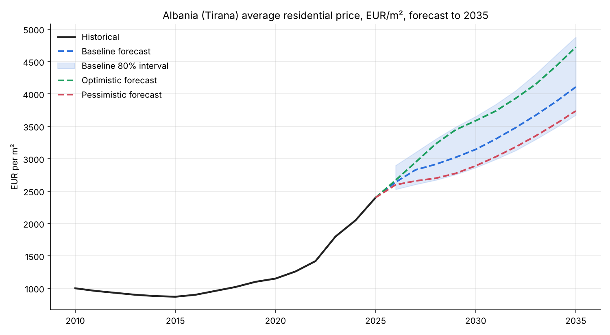

# Albanian Housing Price Forecast to 2035

A machine learning model that forecasts the average residential price in Albania
(Tirana, in EUR per m²) for every year from 2026 to 2035, under three macroeconomic
scenarios. Each forecast comes with an 80% prediction interval.



## Quick start

```bash
pip install -r requirements.txt
python src/housing_model.py
```

Outputs go to `outputs/`:

| File | Contents |
|---|---|
| `forecast_2026_2035.csv` | Point forecast, p10/p50/p90 and annual growth for each scenario and year |
| `forecast_2035.png` | Chart of the historical series and the forecasts |
| `backtest.csv` / `backtest_metrics.csv` | Walk-forward validation results |

## Results (EUR/m²)

| Year | Pessimistic | Baseline | Optimistic |
|---|---|---|---|
| 2025 (actual) | 2,400 | 2,400 | 2,400 |
| 2026 | 2,598 | 2,639 | 2,669 |
| 2028 | 2,699 | 2,914 | 3,229 |
| 2030 | 2,891 | 3,144 | 3,587 |
| 2035 | 3,738 | 4,109 | 4,723 |

Baseline 80% interval for 2035: about 3,670–4,880 EUR/m². The baseline works out to
about +5.5% a year, slightly slower than projected income growth in euros. After the
2022–2025 boom, prices are roughly flat relative to incomes over the period.

## How the model works

1. **Target:** the year-on-year log growth of the price, not the price level. With
   only about 15 years of annual data, a growth target keeps the problem stationary
   and lets the forecast be compounded.
2. **Features:**
   - last year's price growth (momentum)
   - real GDP growth
   - real policy rate (Bank of Albania rate minus inflation)
   - growth in tourist arrivals
   - change in the EUR/ALL exchange rate
   - growth in remittances
   - **valuation gap:** log(price / GDP per capita in EUR) compared with its long-run
     mean. This is an error-correction anchor that pulls prices back toward incomes.
     Without it, momentum compounds and the forecast reaches about 6,900 EUR/m² by 2035.
3. **Models:** Ridge regression, Random Forest and Gradient Boosting, averaged
   into an ensemble.
4. **Validation:** an expanding-window, walk-forward backtest over 2018–2025. Each
   year is predicted using only data from earlier years.

   | Model | Growth MAE (pp) | Price MAPE |
   |---|---|---|
   | **Ensemble** | **4.26** | **4.1%** |
   | Gradient Boosting | 4.33 | 4.2% |
   | Naive (last year's growth) | 4.71 | 4.7% |
   | Ridge | 4.89 | 4.8% |
   | Random Forest | 5.79 | 5.6% |
5. **Forecasting:** the model rolls forward recursively from 2026 to 2035 using the macro
   paths in `data/scenarios.csv`. Uncertainty comes from 2,000 simulated paths that
   bootstrap the backtest residuals.

## Data and caveats (read before relying on the numbers)

- **No official annual EUR/m² series exists for download.** `data/albania_housing.csv`
  is a reconstruction from published reference points:
  - the Keydata/INSTAT Tirana average (about 870 €/m² in 2015, about 1,200 in 2022)
  - the Bank of Albania half-yearly house price index growth rates (for example,
    Tirana +32.6% y/y in H1 2025 and +4.4% y/y in H2 2025)
  - media reports of current asking prices

  The macro columns are approximate values from INSTAT, the Bank of Albania and the IMF.
  **Swap in official data when you have it.** The code reads whatever is in the CSV.
- The scenario macro paths are assumptions, not official projections. Edit
  `data/scenarios.csv` to test your own.
- The series is a Tirana city-wide average. Prime areas (Blloku, the lake towers)
  and coastal markets (Durrës, Vlorë, Sarandë) behave differently.
- Part of the 2023–2025 surge is linked to non-fundamental factors, such as informal
  capital, the fiscal amnesty debate and speculative demand. The model cannot predict
  shocks like a policy crackdown, a credit tightening or a sharp fall in tourism.
- With so few annual observations, the 80% interval probably **understates** the true
  uncertainty, especially after 2030.
